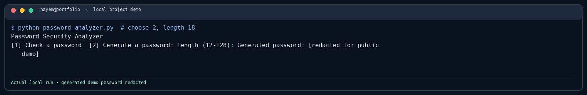
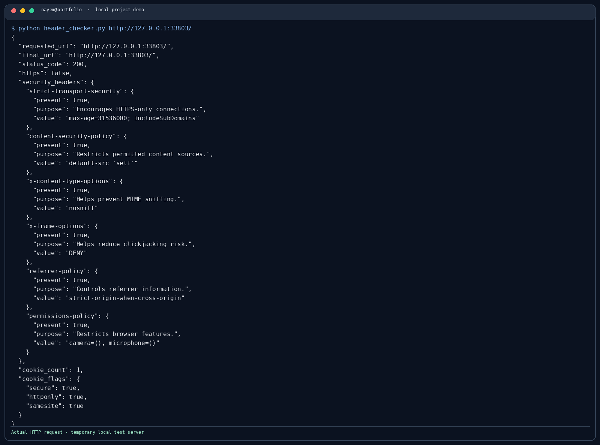
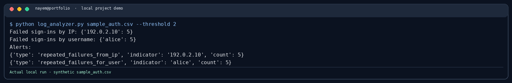
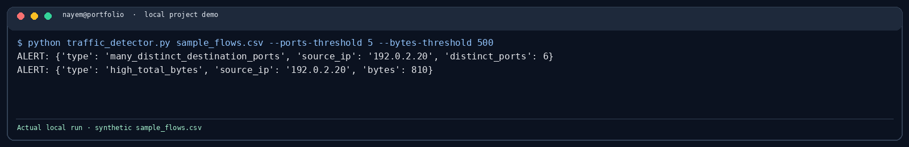
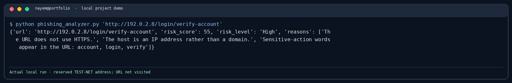
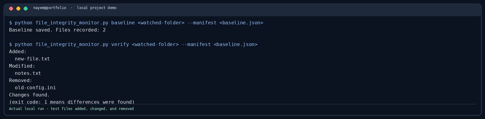
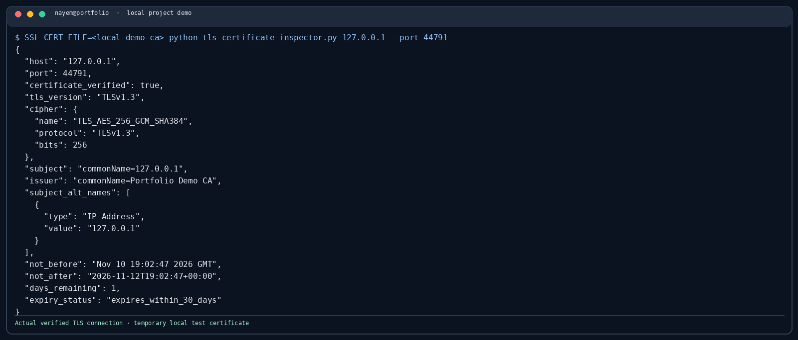

# Cybersecurity Projects

I started this repository to keep the small Python tools I build while learning more about defensive security. Most of them are command-line programs. They use sample files or make one clearly described request, so it is possible to see what they do without setting up a lab.

The projects are for practice and authorized checks. They are not meant to replace a proper security product or a professional assessment.

## Projects

| Project | What it does |
|---|---|
| [Password Security Analyzer](password-security-analyzer/) | Gives basic password feedback and generates random passwords locally. |
| [Web Security Header Checker](web-security-header-checker/) | Checks common HTTP response headers and cookie flags for one URL. |
| [Authentication Log Analyzer](authentication-log-analyzer/) | Counts failed sign-ins in a CSV log and highlights repeated failures. |
| [Network Traffic Anomaly Detector](network-traffic-anomaly-detector/) | Looks at exported flow records for high byte counts and many destination ports. |
| [Phishing URL Risk Analyzer](phishing-url-risk-analyzer/) | Checks URL characteristics offline; it does not open the link. |
| [File Integrity Monitor](file-integrity-monitor/) | Creates a SHA-256 baseline and reports files that were added, changed, or removed. |
| [TLS Certificate Inspector](tls-certificate-inspector/) | Connects once to a host and reports details about its verified TLS certificate. |
| [ML-Based Network Intrusion Detection](research/ml-network-intrusion-detection/) | Compares Logistic Regression and Random Forest on the UNSW-NB15 benchmark with documented preprocessing and evaluation. |

## Project screenshots

The images below show program output from local runs. The log and flow analyzers use the repository's synthetic CSV records; the HTTP and TLS checks use temporary local test servers. The phishing URL analyzer works offline and does not open the URL.

### Password Security Analyzer


### Web Security Header Checker


### Authentication Log Analyzer


### Network Traffic Anomaly Detector


### Phishing URL Risk Analyzer


### File Integrity Monitor


### TLS Certificate Inspector


See [the screenshot notes](docs/screenshots/README.md) for details about the displayed outputs.

## Research project

The network intrusion detection study includes a research question, experiment protocol, dataset provenance, baseline implementation, and an initial analysis of the UNSW-NB15 train/test files. The current results are preliminary and specific to that benchmark split; external validation has not yet been completed.

Start with the [research project README](research/ml-network-intrusion-detection/README.md) and [results analysis](research/ml-network-intrusion-detection/research/results_analysis.md).

## Run locally

Python 3.10 or newer is required.

```bash
git clone https://github.com/NAYEM00000/-cybersecurity-project-portfolio.git
cd -cybersecurity-project-portfolio
python -m pip install -r requirements.txt
```

Each project has its own README with an example command. The web header checker uses `requests`; the other tools use the Python standard library.

## Run the tests

```bash
python -m unittest discover -s tests -v
python -m compileall -q .
```

The GitHub Actions workflows run the applicable checks when code is pushed or a pull request is opened.

## A few limits worth knowing

- The password score is a rough estimate based on character groups. It is not a password-audit service.
- Header and URL checks are simple indicators. A missing header or a high URL score does not prove that a site is vulnerable or malicious.
- The log and traffic tools only analyze the CSV fields provided. They do not know what is normal for a particular organization.
- The file monitor compares hashes with a baseline. Keep the baseline somewhere separate from the folder being monitored.
- The TLS inspector uses Python's default certificate verification. It does not perform a full TLS configuration audit or check certificate revocation.
- The intrusion-detection results describe one benchmark split and are not evidence of production readiness.

Only test systems, URLs, and data that you own or have permission to assess. Sample log and traffic records in this repository are synthetic.

## License

MIT. See [LICENSE](LICENSE).
