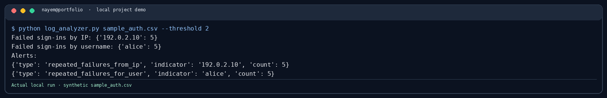

# Authentication Log Analyzer

Counts failed sign-ins by username and source IP in a CSV export.

```bash
python log_analyzer.py sample_auth.csv --threshold 5
```

Required columns: `timestamp,username,source_ip,status`. The included CSV is synthetic. The tool counts the whole file; it does not apply a time window.

## Demo screenshot



See [the screenshot notes](../docs/screenshots/README.md) for how this local demo was run.
