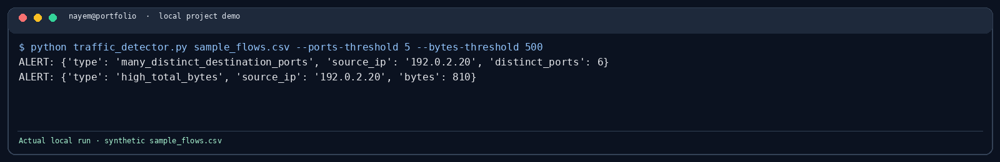

# Network Traffic Anomaly Detector

Reviews an exported flow CSV and flags source addresses with many distinct destination ports or high total byte counts.

```bash
python traffic_detector.py sample_flows.csv --ports-threshold 5
```

Required columns: `timestamp,src_ip,dst_ip,dst_port,bytes,protocol`. It reads exported data only; it does not capture packets or scan hosts. Thresholds need to be adjusted for the network being reviewed.

## Demo screenshot



See [the screenshot notes](../docs/screenshots/README.md) for how this local demo was run.
