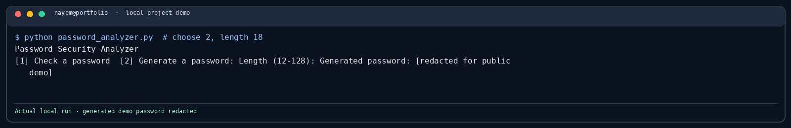

# Password Security Analyzer

A small local tool for checking basic password characteristics or generating a random password.

```bash
python password_analyzer.py
```

The generator uses Python's `secrets` module. The score is only a rough estimate based on length and character groups; it does not check breached-password databases or guessability patterns.

## Demo screenshot



See [the screenshot notes](../docs/screenshots/README.md) for how this local demo was run.
