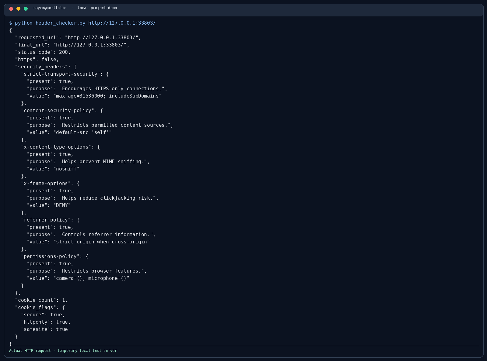

# Web Security Header Checker

Checks common response security headers and cookie flags for one URL.

```bash
python -m pip install -r ../requirements.txt
python header_checker.py https://example.com --json report.json
```

It sends one normal HTTP GET request and follows redirects. Use it only for sites you are authorized to assess. It is not a vulnerability scanner.

## Demo screenshot



See [the screenshot notes](../docs/screenshots/README.md) for how this local demo was run.
